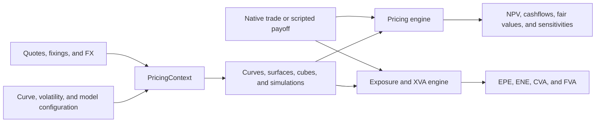

# QuantSupport

QuantSupport (QS) is a quantitative finance library written in Rust. It provides:

- valuation of products across several asset classes;
- market sensitivities computed with automatic differentiation (AD);
- interest-rate and credit curve construction;
- volatility surfaces and cubes;
- Monte Carlo simulation and XVA.

The library uses a few core objects:

- **Market data** holds what you observe: quotes, fixings, and FX rates.
- **Market objects** are built from that data, for example bootstrapped curves
  and implied-volatility surfaces.
- **Instruments** describe the contract terms. **Trades** add your position,
  such as notional and side.
- **Pricers** value a trade using the market objects it needs.

Add the crate to your project with:

```sh
cargo add quantsupport
```

## Bindings

The Python and Excel bindings live in their own repositories, with their own
versions, releases, and documentation.

- **Python:** typed instruments, market data, pricing, and risk analytics. See the [Python README](https://github.com/jmelo11/quantsupport-python/blob/main/README.md) for installation, build instructions, examples, and the API reference.
- **Excel:** a native XLL for 64-bit Windows Excel. See the [Excel README](https://github.com/jmelo11/quantsupport-excel/blob/main/README.md) for downloads, installation, build instructions, and the worksheet API reference.

## Documentation

| What you want | Where to look |
| --- | --- |
| Guides, financial concepts, and conventions | [QuantSupport Book](https://jmelo11.github.io/quantsupport/) |
| Exact signatures, errors, and details of each type | [API reference](https://docs.rs/quantsupport/latest/quantsupport/) |
| Guides for the Python and Excel bindings | [Python documentation](https://jmelo11.github.io/quantsupport-python/python/) and [Excel documentation](https://jmelo11.github.io/quantsupport-excel/excel/) |
| Example notebooks | [Notebook collection](https://github.com/jmelo11/quantsupport-python/blob/main/examples/README.md) |

## Quick start: price and risk a swap

This example prices a five-year USD swap on a notional of USD 10 million. The
swap receives a 3% fixed coupon and pays a floating coupon every six months.

The steps are:

1. Build the swap with `MakeSwap` and wrap it in a trade.
2. Use a flat 3% curve for both projection and discounting.
3. Ask the pricer for the NPV, par coupon, cashflows, and sensitivities.

Conventions used here:

- The fixed coupon accrues with simple ACT/360.
- The 3% curve rate is continuously compounded.
- The floating leg uses one SOFR observation per coupon period. For daily
  compounded overnight coupons, use `MakeOvernightIndexSwap` instead.

```rust
use std::{cell::RefCell, rc::Rc};

use quantsupport::prelude::*;

fn main() -> Result<()> {
    let valuation_date = Date::new(2024, 1, 15);
    let maturity_date = Date::new(2029, 1, 15);
    let notional = 10_000_000.0;

    let swap = MakeSwap::<Recorded>::default()
        .with_identifier("USD_IRS_5Y".to_string())
        .with_start_date(valuation_date)
        .with_maturity_date(maturity_date)
        .with_fixed_rate(0.03)
        .with_notional(notional)
        .with_rate_definition(RateDefinition::new(
            DayCounter::Actual360,
            Compounding::Simple,
            Frequency::Semiannual,
        ))
        .with_currency(Currency::USD)
        .with_market_index(MarketIndex::SOFR)
        .with_side(Side::LongReceive)
        .with_fixed_leg_frequency(Frequency::Semiannual)
        .with_floating_leg_frequency(Frequency::Semiannual)
        .build()?;
    let trade = SwapTrade::new(swap, valuation_date, notional, Side::LongReceive);

    let curve = FlatForwardTermStructure::new(
        valuation_date,
        Recorded::from(0.03),
        RateDefinition::new(
            DayCounter::Actual360,
            Compounding::Continuous,
            Frequency::Annual,
        ),
    )
    .with_pillar_label("SOFR_flat".to_string());

    let mut elements = ConstructedElementStore::default();
    elements.discount_curves_mut().insert(
        MarketIndex::SOFR,
        DiscountCurveElement::new(MarketIndex::SOFR, Rc::new(RefCell::new(curve))),
    );

    let context = PricingContext::new()
        .with_quote_store(QuoteStore::new(valuation_date))
        .with_fixing_store(FixingStore::default())
        .with_base_currency(Currency::USD)
        .with_constructed_elements(elements);

    let pricer = DiscountedCashflowPricer::<Swap<Recorded>, SwapTrade<Recorded>>::new();
    let requests = [
        Request::Value,
        Request::FairRate(0),
        Request::Cashflows(true),
        Request::Sensitivities,
    ];
    let results = pricer.evaluate(&trade, &requests, &context)?;

    let npv = results.price()
        .ok_or_else(|| QSError::ValueNotSetErr("swap NPV".into()))?;
    let par_rate = results.fair_rate()
        .ok_or_else(|| QSError::ValueNotSetErr("swap par rate".into()))?;
    println!("NPV (USD): {npv:.2}");
    println!("Par coupon (decimal): {par_rate:.6}");

    if let Some(risk) = results.sensitivities() {
        for (pillar, exposure) in risk.instrument_keys().iter().zip(risk.exposure()) {
            println!("dPV/dPillar {pillar}: {exposure:.4}");
            println!("Approximate USD P&L for +1 bp: {:.2}", exposure * 1e-4);
        }
    }

    if let Some(cashflows) = results.cashflows() {
        println!("Cashflows: {}", cashflows.payment_dates().len());
    }

    Ok(())
}
```

A related program with a detailed cashflow report is in
[`examples/valuation/swaps`](examples/valuation/swaps).

Expected results:

- The NPV is about -10,723.59 USD.
- The sensitivity to the flat curve rate is -47,405,484.05 USD per unit of
  decimal rate. A one-basis-point rise is therefore worth about -4,740.55 USD.

The NPV is slightly negative because the continuously compounded 3% curve gives
floating coupons a little above the 3% fixed coupon. The receive-fixed side
therefore loses a small amount.

The cashflow table shows signed, undiscounted amounts: receipts are positive and
payments are negative. To reconcile it to the NPV, discount each amount.

## Architecture and components

QuantSupport keeps four parts separate: market data, built market objects,
product definitions, and pricing engines. The same curves, surfaces, and risk
code are then used by deterministic pricing, Monte Carlo, scripting, and XVA.



### Market inputs and conventions

Market data lives in three stores:

- `QuoteStore` holds instrument quotes.
- `FixingStore` holds historical index fixings.
- `FxStore` holds spot FX rates.

Dates, calendars, schedules, day counts, compounding, currencies, and indices
define how to read those values and how to generate product cashflows.

Scenarios shock these inputs. When you price under a scenario, every market
object that depends on a shocked input is rebuilt.

### Market construction

`PricingContext` takes the market data stores and the configuration (which can
be loaded from JSON) and builds the market objects that pricers use. It builds
them in this order:

1. discount and forwarding curves, including multi-curve and collateralized FX
   curves;
2. credit curves bootstrapped from CDS quotes;
3. volatility surfaces and cubes;
4. calibrated models and Monte Carlo simulations.

The built objects are kept in a `ConstructedElementStore`, which all pricing
engines share. Each pricer asks only for the curves, fixings, FX rates,
volatility objects, or paths its trade needs. See the
[market lifecycle](book/src/concepts/pricing-context.md) chapter for details.

For example, build a context from stores and configuration, then initialize it
once before pricing a portfolio:

```rust,ignore
let mut context = PricingContext::new()
    .with_quote_store(quotes)
    .with_fixing_store(fixings)
    .with_fx_store(fx)
    .with_base_currency(Currency::USD)
    .with_base_index(MarketIndex::SOFR)
    .with_curve_configurations(curve_configs)
    .with_volatility_surface_configurations(surface_configs)
    .with_simulation_configurations(simulation_configs);

context.initialize()?;
```

A scenario creates a shocked copy of the market from the context. In this
example, the SOFR quotes rise by one basis point. Curves are rebuilt as pricing
needs them, and the original context is unchanged, so you can price the base
case as well:

```rust,ignore
let scenario = Scenario::new(vec![
    Shock::new("SOFR", 0.0001, ScenarioType::Absolute),
]);
let shocked_market = scenario.apply(&context)?;
let stressed = pricer.evaluate(&trade, &[Request::Value], &shocked_market)?;
let base = pricer.evaluate(&trade, &[Request::Value], &context)?;
```

See [`examples/bootstrap`](examples/bootstrap) for configuration loading and
multi-curve construction, and [`examples/sensitivity`](examples/sensitivity)
for quote-level risk across dependent curves.

### Products: native instruments and scripts

There are two ways to describe a product:

- **Native instruments** cover standard products such as bonds, swaps, caps,
  swaptions, equity and FX options, cross-currency swaps, futures, and CDSs.
  The instrument defines the terms and cashflows. The trade adds the position:
  notional, side, and trade date.
- **Scripted products** describe custom payoffs as a list of dated events. Each
  event can read rates, discount factors, FX rates, or equity prices and make
  payments. Scripts use the same market models and AD as native products. They
  return NPV, expected cashflows, and sensitivities to market quotes, and you do
  not need to write a new instrument or pricer.

Use a native instrument when the product is standard or has a closed-form
model. Use a script for structured coupons, digitals, range accruals,
autocallables, and products whose terms change often. See the
[scripting language](book/src/scripting/language.md) and
[script engine](book/src/scripting/engine.md) chapters.

A scripted product is a list of events, each with a date and some script code.
The event below observes SOFR for one accrual period and pays the coupon into
the `note` variable, which holds the value of the product:

```rust,ignore
let events = vec![CodedEvent::new(
    Date::new(2026, 1, 2),
    r#"
        note = 0;
        accrual = cvg("2026-01-02", "2026-04-02", "Actual360");
        coupon = RateIndex("SOFR", "2026-01-02", "2026-04-02");
        note pays 1000000 * coupon * accrual on "2026-04-02" in "USD";
    "#
    .to_string(),
)];

let stream = EventStream::try_from(events)?;
let engine = ScriptEngine::new(
    stream,
    reference_date,
    Currency::USD,
    MarketIndex::SOFR,
)?;
let (values, cashflows) =
    engine.evaluate_with_cashflows(&mut market_model, Some("note"))?;
```

For XVA, wrap the same `EventStream` in a `ScriptedProduct` and convert it to
contingent claims. [`examples/scripting`](examples/scripting) compares a
scripted swap with a native swap for NPV, pillar sensitivities, and exposure.

### Pricing and risk

A pricer values a trade using the market objects in `PricingContext`.

- Cashflow products are priced by discounting their cashflows.
- Options and rate products with optionality can use Black, Hull-White, LGM, or
  Monte Carlo engines.

A pricer returns an `EvaluationResults` object. It has one optional field per
measure. A field is set only if you requested that measure and the engine
supports it. A missing value means "not computed", not zero.

Sensitivities come from automatic differentiation through both curve building
and pricing. Each market pillar is a labelled input. For bootstrapped curves,
risk is mapped back to the input quotes through the calibration Jacobian. The
same approach is used by native pricers, scripted products, and XVA.

Sensitivities cover only the inputs that each engine differentiates. When a
pricer reuses stored Monte Carlo paths, the inputs used to generate those paths
are held fixed. The result then has no sensitivity to the model parameters or
volatilities behind the paths.

For stress tests and large moves, reprice under quote scenarios instead of
relying on AD sensitivities.

### Exposure and XVA

Supported trades and scripted products can be converted into contingent
claims. Each claim represents one payment. The exposure engine values the claims
on simulated paths and aggregates them by netting set and CSA.

The high-level XVA engine returns:

- NPV cubes before margin;
- exposure profiles at each simulation date;
- CVA and FVA. When variation margin is enabled, these use exposure after margin.

DVA is available through the lower-level aggregator interface.

FVA uses signed exposure. ENE profiles are also signed: they are not absolute
loss amounts.

## Installation

Add the latest release:

```bash
cargo add quantsupport
```

To work from this checkout instead:

```toml
[dependencies]
quantsupport = { path = "../quantsupport" }
```

The prelude exports the types used in most workflows:

```rust
use quantsupport::prelude::*;
```

Build and test the library with:

```bash
cargo build -p quantsupport
cargo test -p quantsupport
```

## Runnable examples

Each example is a workspace package. Some read market data from local JSON files.

| Example | Demonstrates | Run |
| --- | --- | --- |
| [`valuation/swaps`](examples/valuation/swaps) | Flat-curve swap NPV, cashflows, and AAD sensitivity | `cargo run -p valuation-swaps` |
| [`valuation/bonds`](examples/valuation/bonds) | Callable mixed stepped-coupon bond priced by tree and backward Fourier evolution | `cargo run -p valuation-bonds` |
| [`valuation/caps`](examples/valuation/caps) | Black caplet and cap-strip valuation with curve and volatility quote risk | `cargo run -p valuation-caps` |
| [`valuation/loans`](examples/valuation/loans) | Fixed contractual principal, reset requests, prepayment functions, fair-rate modes, credit and quote risk | `cargo run -p valuation-loans` |
| [`bootstrap`](examples/bootstrap) | JSON quote loading, USD/CLP multi-curve bootstrapping, and a corporate bond curve | `cargo run -p bootstrap` |
| [`sensitivity`](examples/sensitivity) | Multi-curve pricing of SOFR, Term SOFR, ICP, and cross-currency swaps with pillar DV01 | `cargo run -p sensitivity` |
| [`risk reprojection`](examples/sensitivity/src/bin/risk-reprojection.rs) | The same OIS priced with deposit, OIS and post-bootstrap zero-rate risk bases | `cargo run -p sensitivity --bin risk-reprojection` |
| [`volatilitysurface`](examples/volatilitysurface) | Building and querying an interpolated SOFR caplet Black-volatility surface | `cargo run -p volatilitysurface` |
| [`hullwhite`](examples/hullwhite) | Curve construction, caplet-vol calibration, Hull-White pricing, simulation, and plots | `cargo run -p hullwhite` |
| [`pfe`](examples/pfe) | Multi-currency LGM exposure simulation for swaps, FX products, and cross-currency swaps | `cargo run -p pfe` |
| [`cva`](examples/cva) | High-level netting-set XVA with CSA, credit/funding inputs, CVA/FVA values, exposure profiles, and AAD sensitivities | `cargo run -p cva` |
| [`scripting`](examples/scripting) | Scripted swap vs native swap: NPV and pillar sensitivities through `ScriptEngine` | `cargo run -p scripting-examples --bin valuation` |
| [`scripting`](examples/scripting) | Scripted product as XVA contingent claims: EPE and CVA/FVA sensitivities vs native swap | `cargo run -p scripting-examples --bin xva` |
| [`scripting`](examples/scripting) | Native callable stepped-coupon bond checked against an equivalent deterministic script | `cargo run -p scripting-examples --bin stepped-coupon-bond` |

The `plot` Cargo feature enables the library's plotting helpers:

```bash
cargo add quantsupport --features plot
```

## Contributing

Contributions are welcome. For small fixes, feel free to open a pull request directly. For larger changes or design discussions, please open an issue first.

Repository maintenance scripts live in [`tools/`](tools/README.md), with their
Python tests in `tools/tests/`.

## License

QuantSupport is released under the [MIT License](LICENSE).

## Contact

For business inquiries, contact <jmelo@live.cl>.
