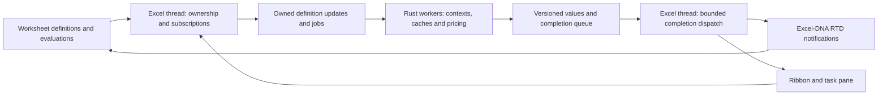

# Excel background pricing engine implementation plan

Status: implemented in the working tree; the 10,000-date workload is benchmarked in desktop Excel. Date: 2026-10-24.

[Measurements and raw results](benchmarks/2026-10-24/README.md): 4.75 s cold for
the paired-context batch with eight workers, 2.17 s unchanged recalculation,
10,000 context/curve builds, and maximum price difference 2.33e-10 USD from
the synchronous reference. The initial 2.35 s definition pass and 127 ms
maximum native dispatch remain visible in the measurements.

The native worker engine, context ownership, RTD companion, asynchronous ribbon
queries and workbook migration are implemented. The 10,000-instrument example is
in `examples/workbooks/origination_10000_batch.xlsx`, with a row-by-row comparison
in `examples/workbooks/origination_10000_valuations.xlsx`; its generator and live
benchmark are in `examples/scripts/`. The benchmark uses 10,000 different
origination dates and independently constructed dated SOFR curves.

Desktop checks cover scalar/spilled delivery, stable context identity, nested
contributions and duplicate errors, stored results, lazy curve views, worksheet/
pane reuse, cancellation and Manual mode. The broader workload and deployment
matrix below remains an acceptance checklist; it is not a claim that every row
has been measured.

## Intended behavior

Preserve this worksheet API:

```text
A1 = QS.CONTEXT.CREATE(...)
A2 = QS.CONTEXT.ADD.CURVE(A1, ...)
A3 = QS.TRADE.CREATE(..., QS.INSTRUMENT.…(...), ...)
A4 = QS.EVALUATE(A1, A3, ...)
```

The context owns its market definitions. Additions update the same logical
context. Evaluation constructs the necessary market objects lazily and reuses
them. Users do not chain addition handles, pass additions to evaluation, or call
`QS.CONTEXT.PREPARE`.

Use a persistent Rust engine inside the loaded native XLL. Worksheet formulas
and the existing ribbon submit work to that engine. Expensive pricing and market
construction run on workers; Excel and the panel remain usable while results
are pending. Continue to distribute the existing native and Excel-DNA XLLs
together, without a separate executable, service, network listener, installer,
new .NET runtime requirement, or administrator registration step.

Worksheet delivery uses RTD-based asynchronous updates through the existing
Excel-DNA companion. The ribbon uses asynchronous job completion directly.
Native asynchronous UDFs are not the default: their calculation lifetime can be
interrupted by sheet interaction. RTD permits background execution, but Excel's
`CalculationState == Done` is not a completion barrier for engine jobs. Define
explicit job/batch completion for ribbon actions and automation.

## Findings that determine the design

| Current code | Required change |
| --- | --- |
| `src/runtime/context.rs` stores separate `ContextInput` objects and eagerly initializes composed contexts in `prepare` | Context-owned contributions, internal revisions and construction on workers |
| `src/runtime/registry.rs` owns thread-local registries and revisioned handles | Keep worksheet ownership on the Excel thread; separate logical context identity from market revision |
| `src/core/pricingcontext.rs` and `src/core/marketdatahandling/marketview.rs` already support lazy construction and caching | Reuse this behavior; avoid eager `initialize()` on worksheet updates |
| Native contexts/caches use `Rc` and `RefCell`; pricing uses thread-local AD tapes | Construct and retain runtime objects on their owner worker; do not transfer registry objects or add unsafe `Send` implementations |
| `ribbon/ExplorerControl.cs` queues `NativeBrowser.Query` as an Excel macro | Queuing a macro still runs pricing on the main thread; replace the blocking query with job submission and completion |
| `src/runtime/browser.rs` requires the current query ABI to run on the main thread | Add an explicit engine ABI instead of putting existing query calls inside `Task.Run` |
| `ribbon/QuantSupport.Ribbon.csproj` already uses Excel-DNA 1.9 and .NET Framework 4.6.2 | Reuse its RTD and UI dispatch support without another end-user dependency |

Paths above are relative to `bindings/excel`, except `src/core/*`, which are
relative to the repository root.

Excel-DNA documents that RTD, ribbons and task panes can run without admin
rights or registration before loading the XLL. This does not override Office
or organization policy. Validate the actual deployment before the wider refactor:
[deployment documentation](https://excel-dna.net/docs/guides-basic/installing-your-add-in/).

## Architecture and contracts



### Context ownership and consistency

- `CREATE` returns a stable, workbook-scoped context identity. Keep the workbook
  session/reset epoch and input revision separately; an old workbook handle must
  never resolve after close, reopen or reset. Recalculating unchanged `CREATE`
  must preserve contributions.
- Each successful `ADD.*` replaces its calling cell's contribution rather than
  appending on every calculation. Give multiple contributions from one cell
  stable invocation identities and cover this with lifecycle tests.
- Associate contributions with the context, including quotes, fixings, FX,
  curves, credit, volatility and model/pricer/simulation configuration. Preserve
  duplicate-data errors and quote-side merging rules.
- Clearing, replacing or deleting an addition cell removes its contribution.
  Changing its target context detaches the old contribution. A failed update
  marks the affected context invalid; never quietly price previous inputs as
  current. Retain the source cell and diagnostic.
- Stage updates and commit once per affected context after the worksheet's
  definition pass has settled. An initial evaluation can register before its
  additions have run: it stays pending until that pass is committed. Build the
  context once from the complete batch, not after each addition.
- Use Excel calculation lifecycle notifications and a guarded command dispatcher,
  including a programmatic-calculation path. Do not rely solely on the native
  `CalculationEnded` event, which Microsoft documents as absent for programmatic
  recalculation, or use a fixed sleep as a completeness test.
- Changes enqueue work for registered consumers even when their formula arguments
  contain only the stable context handle. Result-triggered recalculation with
  unchanged definitions must not create another market revision or job.
- Detect cycles in registered dependencies and stop repeated revision churn with
  a source diagnostic. Price-derived inputs must not create an unbounded hidden
  recalculation loop. Do not claim support for arbitrary circular market formulas.

### Worker engine

- Introduce `runtime/engine` modules for owned definitions, commands, scheduling,
  job state, completions and metrics. Commands contain only thread-safe owned
  data/IDs; workers materialize native contexts, instruments, trades, policies
  and pricers from normalized definitions on their own thread.
- Retain definitions and constructed objects across jobs. Send only changed
  definitions; do not serialize an entire context or copy its history per trade.
  Add definition DTOs where current constructors retain only native objects.
- Start with a bounded worker pool and context affinity: one context revision's
  market cache belongs to an assigned worker. Different contexts can run
  concurrently. Same-context trade batches share construction. Do not promise
  same-context parallel valuation until its cache/AD costs are measured.
- Key work by session epoch, context identity/revision, instrument/trade revision,
  position terms, pricer/policy revision and requested measures. Separate result
  presentation options from computation where safe. Identical worksheet and
  ribbon requests share computation and have independent subscribers.
- Coalesce superseded jobs, bound queues and caches, and prioritize current
  interactive requests without starving worksheet batches. Never create a thread
  for each cell. Avoid multiplying worker threads by unrestricted internal Rayon
  parallelism.
- Publish only detached numbers, strings, errors, tables and opaque result IDs.
  Keep AD/native evaluation objects on their worker. Apply AD recording/reset
  guards to successful, failed and canceled worker jobs.
- Tag every completion with its epoch, input revision and subscriber generation.
  Discard obsolete completions before either worksheet or ribbon publication.
- Cancel queued work immediately. Add cooperative cancellation to long numerical
  loops where needed; a noninterruptible native call may finish, but its canceled
  result must be discarded. Never block Excel waiting for that call to end.
- Workbook close and reset retire subscriptions and epochs. XLL unload must stop
  callbacks and preserve the DLL's lifetime until workers can exit safely; no
  worker may execute unloaded code. Test this separately from workbook closure.

### Worksheet result delivery

- Keep public `QS.*` registrations unique and the function catalog authoritative.
  Preferred route: native evaluation wrappers call a private Excel-DNA RTD
  subscription helper in worksheet context. The helper supplies a small change
  token; wrappers read ready typed results and produce the existing scalar/spill
  output. Prove that updates re-evaluate the enclosing native formula in phase 1.
- If nested native-to-managed subscription calls cannot preserve Excel dependency
  or caller semantics, use managed wrappers for just the asynchronous public
  exports, backed by the same native engine ABI. Remove their native registrations
  and update catalog generation together. Do not register duplicate public names.
- RTD topics identify subscriptions, not large JSON result payloads. Coalesce
  notifications and drain completions in bounded batches. Avoid one COM call or
  timer per cell; workers never access Excel COM or arbitrary Excel C APIs.
- Pending numeric outputs return an Excel error/pending value, with a
  `Calculating…` source diagnostic; choose and test the supported error in the
  prototype. Never return a text placeholder or present an old value as current.
- Cover scalar values, cashflows, sensitivities, range batches, portfolio pricing
  and historical batches. Stored-result handles must be revisioned on completion;
  result accessors must not dereference native objects on another thread.
- Subscribe context quote/fixing getters and market-dependent curve views to
  internal revisions as well; the stable root handle cannot update these through
  Excel's ordinary cell dependencies alone.
- Snapshots capture a committed context's inputs without eagerly constructing
  its market. Historical selection/materialization runs on workers.
- Preserve the user's calculation mode. Automatic mode updates through RTD.
  In Manual mode, define a QuantSupport refresh action that asynchronously awaits
  a batch and safely refreshes its worksheet consumers. Document F9/RTD limitations
  instead of silently switching Excel to Automatic.
- Do not silently change the application-wide persistent RTD throttle setting.
  Measure the existing interval separately from engine latency. Any lower interval
  must be an explicit setting with its application-wide effect explained.

### Ribbon and native ABI

- Add a versioned engine ABI for submit, cancel, status and taking ready results.
  Submission captures validated owned definitions on the Excel thread and returns
  a job ID immediately. Retrieval never waits for a worker. Use typed payloads
  for large numeric outputs; JSON remains suitable for small control metadata.
- Use one completion signal to wake a managed dispatcher; drain a bounded queue
  and notify RTD or the requesting pane. Do not poll the full object registry for
  job completion. Retain explicit buffer ownership/free functions.
- Replace the heavy `NativeBrowser.Query` path in `ExplorerControl.RunQuery` with
  submission, progress, cancel and completion. UI continuations validate window,
  workbook session, selection generation and input revision before rendering.
- Keep Excel object access, handle validation and pane updates on the main thread.
  Only computation uses workers. No `.Wait()`, `.Result`, long worker lock, or
  nested message-pump waiting on the UI thread.
- Preserve current virtual grids and localized formatting. Chunk or page large
  result conversion/rendering so completion processing does not create a new UI
  stall. Cheap metadata browsing remains cheap and does not launch pricing.
- Bump the browser ABI where its query semantics change, update contract fixtures,
  and reject mixed releases clearly. Integrate cancellation into pane disposal,
  selection changes, workbook close, Reset Memory & Rebuild and add-in shutdown.

## Ordered implementation milestones

1. **Prove delivery and capture the baseline.** Build a background job,
   private RTD helper and native scalar/spill wrapper using the existing package.
   Test from an ordinary Windows account without an installer, service or manual
   COM registration. Verify editability, native caller ownership, load order,
   Manual/Automatic modes and teardown. Compare native async and RTD delivery
   overhead. Record deployment-policy failures without changing security settings.
   This is the feasibility gate before changing public context behavior.
2. **Build the engine and definition protocol.** Add portable scheduler tests,
   worker-owned native materialization, a bounded completion channel, version
   checks, deduplication, cancellation and metrics. Test a slow synthetic job and
   one real deposit/swap against current direct native results.
3. **Change context ownership.** Implement stable context IDs, cell contributions,
   batch commits and lifecycle removal/error handling. Replace `prepare` with
   internal lazy resolution; ensure consumers can register before additions run.
4. **Connect worksheet evaluation.** Implement the proven RTD route and cover
   scalar, spilled and stored results. Move range/portfolio/history workloads and
   market-dependent getters/views to the engine. Add explicit engine completion
   status for refresh and automation.
5. **Connect the ribbon.** Add asynchronous submit/cancel/completion to pricing
   and expensive curve queries. Keep the panel interactive and share job/cache
   state with worksheet subscribers. Complete reset/close/unload handling.
6. **Migrate the public API and artifacts.** Remove `QS.CONTEXT.PREPARE` and the
   evaluation `inputs` argument; update registration, function help, IntelliSense,
   ribbon wording, snapshot usage, example generators, generated workbooks and
   contract fixtures together. Keep all function argument positions documented
   and require matching package/workbook versions. Both existing XLLs are needed
   for streaming; a missing bridge produces a clear diagnostic rather than a
   blocking fallback.
7. **Validate and tune on Windows Excel.** Run lifecycle, responsiveness and
   numerical tests with the full matching release package; profile and tune the
   measured bottlenecks. Publish benchmark results and remaining limitations.

## Validation and performance acceptance

Numerical parity uses existing reference workflows for values, fair rates,
cashflows, sensitivities, bonds with anchors, loans, portfolios and historical
batches. Keep native product semantics unchanged; the work changes ownership,
scheduling and delivery. Test scalar and changing spill shapes, output headers,
locale formatting and stored result accessors.

Lifecycle tests must cover first calculation with evaluation invoked before its
additions, rapid quote edits, bulk paste, identical recalculation, bad/missing
inputs, deleting/replacing/moving addition formulas, root parameter changes,
duplicate inputs, worksheet removal, workbook isolation and save/reopen. Exercise
late completions, cancel/retry, pane closure, changing selection/workbooks, reset,
shutdown and programmatic calculation. Verify that an obsolete revision never
overwrites a newer one and that completion notifications cannot loop indefinitely.

Benchmark separately on the target Windows/Excel hardware:

| Workload | Measurements |
| --- | --- |
| 1 / 1,000 / 10,000 valuations sharing a context | Cold/warm completion time; cache hits; construction count; peak memory |
| One quote edit and bulk edits | Commit count; canceled/superseded work; jobs priced; time to final cell value |
| Several independent contexts | Parallel scaling; CPU usage; queue delay; worker/cache duplication |
| Pricing or sensitivities from worksheet and ribbon together | Deduplication; interactive request delay; throughput |
| Large cashflow/history outputs | Result conversion/render cost; spill correctness; notification count |
| Five-second synthetic job during typing and pane use | UI heartbeat p50/p95/max delay; visible input responsiveness |
| Repeated unchanged calculations and open/close/reset cycles | No unnecessary calibration or jobs; bounded memory and subscriptions |

Instrument stages independently: argument capture, commit, queue wait, native
construction, pricing, result conversion, notification and Excel repaint.
RTD's default display interval is 2 seconds; do not misreport that interval as
pricing time or hide it inside a claimed speedup.

Initial engineering targets, to verify against the baseline rather than claim
as measured results: ordinary submission never waits for pricing; UI heartbeat
p95 delay below 50 ms during the synthetic workload; no engine submission or
completion handler occupies the UI thread for more than 100 ms. Chunk large
imports/results and report any unavoidable Excel-side stalls separately. Each
unchanged materialized context revision builds its required market dependencies
once per owner worker; result notifications do not reprice unchanged requests.
Set end-to-end latency budgets from the phase-1 measurements on the deployment
machine before accepting the full implementation.

Run portable Rust scheduler/registry/market tests, managed ABI contract tests and
generated-workbook/catalog checks. Extend the Windows binding build and add live
Excel tests alongside `examples/tests/test_lifecycle_live.py`. The existing hosted
Windows build does not prove interactive Excel behavior; run those checks on a
machine with desktop Excel. Planning on macOS cannot validate this deployment.

## Reference behavior

- [Excel-DNA deployment and RTD without preregistration](https://excel-dna.net/docs/guides-basic/installing-your-add-in/).
- [Excel-DNA registration-free RTD helper](https://excel-dna.net/docs/guides-basic/excel-programming-interfaces/excel-c-api/).
- [Native async versus RTD tradeoffs, from the xlOil maintainers](https://xloil.readthedocs.io/en/latest/Concepts.html#rtd-async).
- [Excel-DNA maintainer on interaction and native async](https://groups.google.com/g/exceldna/c/7YxP_6cCpl8).
- [Microsoft async calculation behavior](https://learn.microsoft.com/en-us/office/client-developer/excel/excel-recalculation).
- [Microsoft calculation lifecycle events and programmatic-calculation limitation](https://learn.microsoft.com/en-us/office/client-developer/excel/handling-events).
- [Microsoft Office threading model](https://learn.microsoft.com/en-us/visualstudio/vsto/threading-support-in-office?view=vs-2022).
- [Microsoft RTD throttle interval](https://learn.microsoft.com/en-us/office/vba/api/excel.rtd.throttleinterval).
