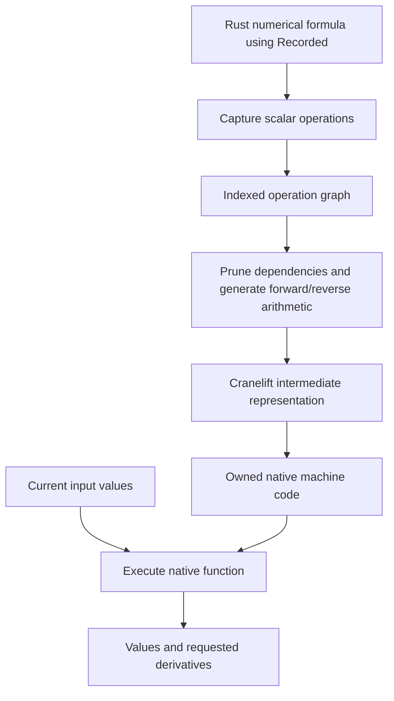

# Inside automatic differentiation and the JIT

Automatic differentiation (AD) applies the chain rule to a numerical program.
QuantSupport records scalar arithmetic and uses reverse-mode, or adjoint, AD
for valuation gradients. Its just-in-time (JIT) compiler turns the value and
derivative calculations into native machine code using Cranelift. The same
Rust pricing formula supplies the numerical value and the operations needed
to differentiate it; generated code can then run with fresh input values.

This chapter follows the implementation in `src/ad`, from a recorded number to
a reusable native function. The [market sensitivities chapter](../risk/aad.md)
explains how to request risk, interpret its units and change its reporting basis.



## What a recorded scalar contains

`Scalar` defines the arithmetic shared by `f64` and `Recorded`. Generic curves,
cashflows and models can therefore express their numerical formulas using one
scalar interface. `Recorded` is a small, copyable value containing a primal
`f64`, an operation index, an owning capture token and a capture-policy flag.
The primal is the ordinary numerical result of the calculation so far.

During an active recording, an arithmetic operator calculates that primal and
appends an `Operation` to a vector. An instruction such as `Mul(a, b)` refers to
earlier instructions by index. Operand indices are stored inline; the recording
contains the operations and their dependencies. The compiler generates local
derivative formulas from those operation kinds later.

Independent inputs must be identified explicitly. In an ordinary pricing
capture, `Recorded::new(value)` creates an input, while `Recorded::constant`,
`Recorded::from` and `Recorded::detached` create values with no independent
market derivative. Outside a capture, a `Recorded` can hold a persistent
numerical value in an instrument or market object. The pricing boundary
registers the market pillars that should become independent risk factors.
`Graph::trace` registers its supplied input slice automatically.

The active recording lives in thread-local storage. Its token identifies which
capture owns each expression. Strict graph expressions must remain inside their
capture and on their owning thread. Persistent numerical market objects can be
registered in a later pricing capture. `RecordingScope` temporarily suspends an
enclosing recording and restores it on drop, including during unwinding. This
lets isolated market construction run without mixing expression identities.

## From a financial formula to a graph

Consider a payment of amount \\(C\\) after \\(T\\) years, discounted at a
continuously compounded rate \\(r\\):

\\[
V(C,r)=C\exp(-rT).
\\]

With \\(T=2\\) fixed in the formula, the runtime inputs are \\([C,r]\\).
The dependencies can be read as follows; individual scalar instructions also
represent the negation, multiplication and literal maturity:

| Quantity | Calculation | Dependency |
| --- | --- | --- |
| \\(C\\) | Load input 0 | Payment amount |
| \\(r\\) | Load input 1 | Discount rate |
| \\(u\\) | \\(-rT\\) | Rate and fixed maturity |
| \\(d\\) | \\(\exp(u)\\) | Discount factor |
| \\(V\\) | \\(Cd\\) | Amount and discount factor |

`Graph` validates a topologically ordered instruction list: input instructions
form a prefix, every operand precedes its consumer, and the output identifies
an existing instruction. This order allows a forward traversal to compute all
required primal values.

The following complete example records the formula once, compiles it once and
checks two executions against its analytical derivatives:

```rust
# extern crate quantsupport;
use quantsupport::prelude::*;

let graph = Graph::trace(&[100.0, 0.05], |x| {
    x[0] * (-x[1] * 2.0).exp()
})?;
let kernel = graph.compile()?;

for inputs in [[100.0, 0.05], [120.0, 0.03]] {
    let discount = (-2.0_f64 * inputs[1]).exp();
    let mut gradient = [0.0; 2];
    let value = kernel.value_and_grad(&inputs, &mut gradient)?;
    assert!((value - inputs[0] * discount).abs() < 1e-12);
    assert!((gradient[0] - discount).abs() < 1e-12);
    assert!((gradient[1] + 2.0 * value).abs() < 1e-12);
}
# Ok::<(), Box<dyn std::error::Error>>(())
```

The closure runs during capture. Later calls execute the generated function
with the supplied amount and rate. Maturity is a constant in this graph; to
change it without recapturing, make it another runtime input. Gradient entries
follow the input order. Here the rate derivative is per unit decimal rate, so
multiplying it by `0.0001` estimates the PV change for a +1 bp move.

## How reverse differentiation works

For an intermediate quantity \\(z\\), its adjoint
\\(\bar z=\partial V/\partial z\\) measures how the output responds to that
quantity. Reverse differentiation starts with \\(\bar V=1\\) and visits
instructions in reverse dependency order. Each instruction adds its local
chain-rule contributions to the adjoints of its operands.

For \\(z=ab\\), the contributions are
\\(\bar a\mathrel{+}=\bar z b\\) and
\\(\bar b\mathrel{+}=\bar z a\\). Contributions add because one intermediate
may influence the result through several later operations. For
\\(z=\exp(a)\\), the contribution is \\(\bar a\mathrel{+}=\bar z z\\),
using the forward value already computed for the exponential.

Applied to the payment:

| Reverse step | Contributions |
| --- | --- |
| \\(V=Cd\\), seeded with \\(\bar V=1\\) | \\(\bar C=d\\), \\(\bar d=C\\) |
| \\(d=\exp(u)\\) | \\(\bar u=Cd=V\\) |
| \\(u=-rT\\) | \\(\bar r=-TV\\) |

This produces all input derivatives of the scalar output from a forward
calculation and a reverse calculation over its dependencies. The work follows
the size of that calculation; it avoids a separate repricing for every input.
The arithmetic uses floating-point values, and numerical approximations in the
underlying pricing method still affect the result.

## What Cranelift compiles

`jit::compile_selected` first prunes operations that cannot affect the selected
reverse root or requested observations. Input slots retain their ordering.
It then constructs Cranelift intermediate representation, a lower-level
description of the numerical instructions:

1. Input loads and constants supply native `f64` values. Arithmetic operations
   become Cranelift floating-point instructions. Functions such as `exp`, `ln`,
   `sin`, `cos`, `pow` and the normal CDF call registered host functions.
2. Activity analysis identifies which values depend on the active input prefix.
   Reverse traversal emits derivative arithmetic only for active dependencies.
   Adjoint contributions become generated additions and multiplications.
3. Cranelift compiles and finalizes the function with its optimization level set
   to `speed`. The JIT module provides a callable function pointer and owns the
   executable memory.

The graph traversal and derivative-rule dispatch happen during compilation.
The resulting native function executes the forward and reverse arithmetic
directly. Cranelift assigns its intermediate values to machine registers or
stack storage as needed.

The function uses a C ABI with three pointers: inputs, output values and
derivatives. `NativeKernel` checks the slice lengths before entering that code.
`CompiledKernel` holds its owner through `Arc`, so clones can share executable
code while each invocation supplies separate buffers. The last owner releases
the JIT module's memory. The ownership mutex is used to retain and release the
module; native evaluation calls the function pointer without locking it.

A scalar `CompiledKernel::value_and_grad` call performs no recording or heap
allocation. Other interfaces have their own workspace costs: second-order
helpers and the large-graph execution route allocate temporary buffers.

## Ordinary pricers, code caches and large graphs

Built-in pricers manage recording around a valuation. They register market
pillars, calculate a recorded PV and run native differentiation when a
sensitivity request needs it. `Recorded::differentiate` clears earlier input
derivatives; `differentiate_accumulating` adds the current result to them.
Reported labels come from the registered market inputs.

Before native differentiation, the recording exports the expression reachable
from the result. Export resolves calibrated-input substitutions and places
independent inputs in a canonical prefix. It also lifts reachable literal
values into inactive runtime slots. These slots can carry changing numerical
constants, including random draws, without generating derivatives for them.

Ordinary pricing captures the current arithmetic before looking up native
code. Its thread-local cache hashes the exported graph and verifies matching
instructions, input layout, active-input count and output before reuse. Hash
equality alone does not establish compatibility. Cache budgets bound retained
programs; an evicted program can be compiled again on a later call.

`GradientKernel` limits compilation size for large ordinary-pricer graphs.
The current implementation partitions graphs above 2,048 operations into
blocks covering up to 384 non-input graph instructions. Each block has a
compiled forward function for the values needed beyond its boundary and a
compiled reverse function for the boundary adjoints.

Execution visits forward blocks in dependency order, retains their boundary
values, then visits reverse blocks with the accumulated output seeds. Each
reverse block computes a vector-Jacobian product and adds it to preceding
boundaries. The outer execution manages buffers and block calls; the arithmetic
and derivative rules inside each block execute as native code. Compatible
blocks can share code through a bounded cache shared across threads.

`Recording::checkpoint` and `restart` address another source of repeated work:
they retain an immutable setup prefix while discarding transient path
instructions. Each path's native gradient already includes its setup
dependencies, and its input derivatives can accumulate across paths.

## Branches and the conditions for reuse

A Rust `if` executes while recording and captures its selected arm. The AD
interfaces handle reuse according to how that control flow was captured:

| Interface | Handling of input-dependent Rust comparisons |
| --- | --- |
| `Graph::trace` / `try_trace` | Rejects the capture with `DynamicControlFlow`; input-dependent primal-value extraction is also rejected. |
| `CompiledProgram` | Stores comparison guards and checks them at every execution. A changed Boolean decision returns `ComparisonChanged`. |
| Ordinary pricing recording | Captures the current calculation again before checking native-code compatibility. |

Use recorded `max_val`, `min_val` or `select_greater` for numerical decisions
that must vary inside one reusable graph. Selection retains both scalar arms
and chooses the result at execution time. Its derivatives follow the selected
arm; the predicate contributes zero derivative.

This complete guarded example captures a positive-input branch, accepts
another positive value and rejects an input that would take the other arm:

```rust
# extern crate quantsupport;
use quantsupport::prelude::*;
use quantsupport::ad::CompileError;

let program = CompiledProgram::trace(&[1.0], 1, |x| {
    let value = if x[0] > 0.0 { x[0] * x[0] } else { -x[0] };
    Ok::<_, &str>((value, vec![value]))
})?;
let mut outputs = vec![0.0; program.output_count()];
let mut gradient = [0.0];
program.evaluate(&[2.0], &mut outputs, &mut gradient)?;
assert_eq!(outputs[0], 4.0);
assert_eq!(gradient, [4.0]);
assert!(matches!(
    program.evaluate(&[-1.0], &mut outputs, &mut gradient),
    Err(CompileError::ComparisonChanged),
));
# Ok::<(), Box<dyn std::error::Error>>(())
```

Guard operands are additional observations, which is why the example allocates
`program.output_count()` output slots. Guards are checked after the numerical
function runs. Callers must discard results on an error and recapture for the
new branch; the program does not recapture automatically.

`CompiledProgram::trace_reusing` performs a fresh capture and retains previous
machine code only when the instructions, constant bits, root, observation
ordering, guards and input layouts match. Runtime values can change within
that layout. This differs from the ordinary-pricer export described above,
which explicitly lifts literals into inactive input slots.

Local derivative conventions also matter. `max` and `min` give both operands
zero derivatives at a tie; `abs` has zero derivative at zero. Hard selection
predicates have zero pathwise derivatives. The normal CDF uses the library's
numerical CDF value with analytic Gaussian derivative rules. These conventions
describe the implemented local calculation at nonsmooth or approximated points.

## Prepared simulation programs

`CompiledProgram` separates a scalar risk root from additional observed values.
Its capture closure returns `(risk_root, observations)`: recording an exposure
or payment as an observation does not automatically add it to the quantity
being differentiated. Only the leading `active_inputs` receive derivatives;
later input slots can hold fixed random draws or other inactive coefficients.

Supported XVA and parallel scripting workloads prepare a numerical path
program using this interface. Preparation obtains current model coefficients
and their Jacobian to the published market factors. Each path supplies those
coefficients and its indexed random draws, then the native program computes
fresh values and coefficient gradients. The engine composes those gradients
with the coefficient-to-market Jacobian to produce labelled risk.

Each worker owns its mutable execution buffers and shares the compiled code.
`CompiledKernel::sum_paths` similarly accumulates unnormalized values and
gradients using Rayon. Its reduction order is reproducible for a fixed pool
size; callers apply their estimator's normalization.

Code compatibility and current market binding are separate requirements.
`XvaEngine::update_market` refreshes market snapshots and calibration; the next
preparation refreshes coefficients and their risk map. Compatible code can
remain shared. Changed contracts, model layouts or collateral agreements can
require recapture and compilation. The [exposure chapter](../simulation/exposure.md)
describes the engine lifecycle, and [script valuation](../scripting/engine.md)
describes prepared and per-path recording routes.

## Second derivatives and calibration maps

The default `DerivativeOrder::First` compiles value and gradient calculations.
Selecting `Second` additionally builds a graph for
\\(g(x,v)=\nabla f(x)^{\mathsf T}v\\). Its runtime inputs are \\([x,v]\\).
Reverse differentiation of this graph with respect to \\(x\\) gives
\\(H_f(x)v\\), with no bump step size. A dense Hessian repeats this
directional evaluation for the coordinate directions and stores the result
in row-major order. First-order calls continue to use only the first-order
function. Dense storage grows quadratically with the input count.

`CompiledFunction` extends capture to vector outputs. Its Jacobian kernel
shares a forward calculation and generates a reverse calculation per output
row. A separate values-only kernel performs no derivative work. Optional
second-order compilation supplies each output's Hessian.

Calibration introduces a further chain rule. At a converged residual system
\\(F(s,q)=0\\), solved states \\(s\\) depend on quotes \\(q\\) through

\\[
F_s\frac{\partial s}{\partial q}=-F_q.
\\]

`ImplicitDerivatives` uses residual derivatives from a `CompiledFunction` to
solve this system and compose downstream observations. The caller supplies
converged states and appropriate residuals; the state Jacobian must be locally
nonsingular. Optional second-order residuals also supply calibration curvature.

Some pricing integrations instead attach an existing first-order calibration
map using `Recorded::set_linearization`. Locally, a solved parameter is
represented as \\(s_0+J(q-q_0)\\). This preserves its calibrated value and
first derivatives, while the map itself supplies no calibration curvature.
Rate-bootstrap and model-calibration paths still include numerical-difference
maps, as detailed in [calibration coverage](../risk/aad.md#calibration-dependencies).
The availability of native Hessian kernels therefore does not imply complete
second-order risk through every market construction. Public pricing and XVA
sensitivity requests currently report first-order risk.

## Reading the source

| Implementation | Responsibility |
| --- | --- |
| [recorded.rs](https://github.com/jmelo11/quantsupport/blob/main/src/ad/recorded.rs), [recording.rs](https://github.com/jmelo11/quantsupport/blob/main/src/ad/recording.rs) | Scalar recording, capture ownership, export and ordinary-pricer code reuse |
| [operation.rs](https://github.com/jmelo11/quantsupport/blob/main/src/ad/operation.rs), [graph.rs](https://github.com/jmelo11/quantsupport/blob/main/src/ad/graph.rs) | Indexed instructions, graph validation, pruning and symbolic directional derivatives |
| [jit.rs](https://github.com/jmelo11/quantsupport/blob/main/src/ad/jit.rs), [nativekernel.rs](https://github.com/jmelo11/quantsupport/blob/main/src/ad/nativekernel.rs) | Forward/reverse lowering, native ABI, checked buffers and executable-memory ownership |
| [gradientkernel.rs](https://github.com/jmelo11/quantsupport/blob/main/src/ad/gradientkernel.rs) | Partitioned first-order execution and shared native blocks |
| [compiledkernel.rs](https://github.com/jmelo11/quantsupport/blob/main/src/ad/compiledkernel.rs), [compiledprogram.rs](https://github.com/jmelo11/quantsupport/blob/main/src/ad/compiledprogram.rs) | Reusable scalar/path kernels, derivative orders and guarded multi-output programs |
| [compiledfunction.rs](https://github.com/jmelo11/quantsupport/blob/main/src/ad/compiledfunction.rs), [implicitderivatives.rs](https://github.com/jmelo11/quantsupport/blob/main/src/ad/implicitderivatives.rs) | Vector residuals, Jacobians and derivatives through calibration |

The [benchmark runners](https://github.com/jmelo11/quantsupport/blob/main/tools/README.md#benchmarks) separate capture,
compilation, market refresh and repeated native execution. These costs matter
at different workload sizes: a small valuation may be dominated by preparation,
while repeated path calculations can amortize it over many executions.
