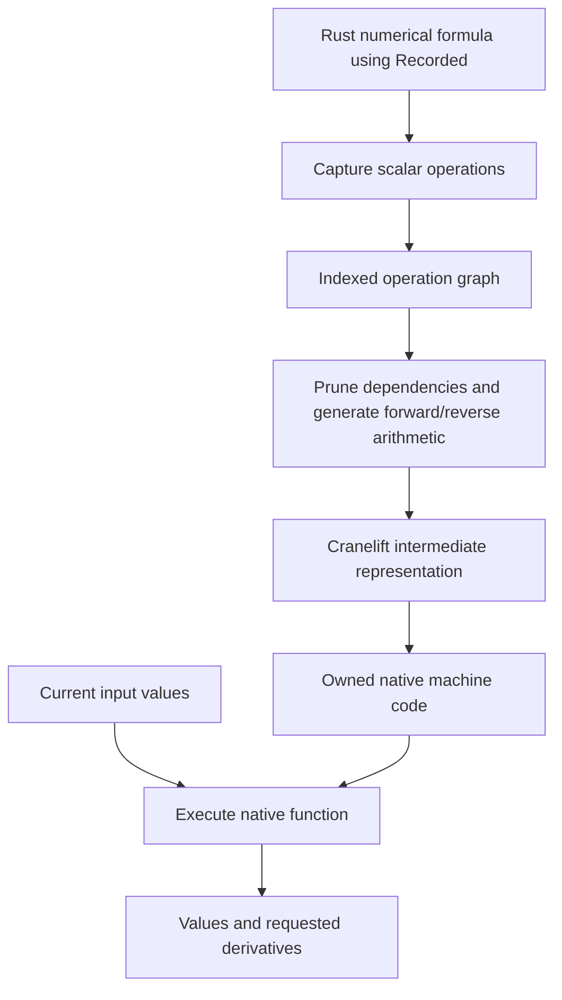

# Inside automatic differentiation and the JIT

Automatic differentiation (AD) applies the chain rule to a numerical program.
QuantSupport records scalar arithmetic and uses reverse-mode (adjoint) AD to
compute valuation gradients. A just-in-time (JIT) compiler built on Cranelift
turns the value and derivative calculations into native machine code.

The same pricing formula gives both the value and the operations needed to
differentiate it. The compiled code can then be run again with new input
values.

This chapter follows the code in `src/ad`, from a recorded number to a reusable
native function. To request risk, read its units, or change its reporting
basis, see the [market sensitivities chapter](../risk/aad.md).



## What a recorded scalar contains

`Scalar` defines the arithmetic shared by `f64` and `Recorded`, so generic
curves, cashflows, and models can be written once for both types.

`Recorded` is a small `Copy` value that holds:

- the primal value: the ordinary `f64` result of the calculation so far;
- the index of the operation that produced it;
- a token for the recording that owns it;
- a flag for the recording policy.

While a recording is active, each arithmetic operation computes the primal
value and appends an `Operation` to a list. An instruction such as `Mul(a, b)`
refers to earlier instructions by index. The recording stores only the
operations and their dependencies. The compiler derives the local derivative
formulas from the operation kinds later.

You must mark the independent inputs explicitly:

- In a pricing recording, `Recorded::new(value)` creates an input.
- `Recorded::constant`, `Recorded::from`, and `Recorded::detached` create
  values with no market derivative.
- Outside a recording, a `Recorded` is a plain number stored in an instrument or
  market object.
- Pricers register the market pillars that become risk factors.
  `Graph::trace` registers its input slice automatically.

The active recording is stored per thread. Its token shows which recording owns
each expression.

- Graph expressions must stay inside their recording and on its thread.
- Market objects that hold plain numbers can be registered again in a later
  pricing recording.
- `RecordingScope` pauses the current recording and restores it when dropped,
  including during a panic. This lets market construction run on its own
  without mixing expressions from different recordings.

## From a financial formula to a graph

Take a payment \\(C\\) due in \\(T\\) years, discounted at a continuously
compounded rate \\(r\\):

\\[
V(C,r)=C\exp(-rT).
\\]

With \\(T=2\\) fixed in the formula, the inputs are \\([C,r]\\). The
dependencies are below. The actual scalar instructions also include the
negation, the multiplication, and the literal maturity:

| Quantity | Calculation | Dependency |
| --- | --- | --- |
| \\(C\\) | Load input 0 | Payment amount |
| \\(r\\) | Load input 1 | Discount rate |
| \\(u\\) | \\(-rT\\) | Rate and fixed maturity |
| \\(d\\) | \\(\exp(u)\\) | Discount factor |
| \\(V\\) | \\(Cd\\) | Amount and discount factor |

`Graph` checks that its instruction list is in dependency order:

- input instructions come first;
- every operand comes before the instruction that uses it;
- the output refers to an existing instruction.

A single forward pass can then compute every value.

This complete example records the formula once, compiles it once, and checks
two runs against the exact derivatives:

```rust
# extern crate quantsupport;
use quantsupport::prelude::*;

let graph = Graph::trace(&[100.0, 0.05], |x| {
    x[0] * (-x[1] * 2.0).exp()
})?;
let kernel = graph.compile()?;

for inputs in [[100.0, 0.05], [120.0, 0.03]] {
    let discount = (-2.0_f64 * inputs[1]).exp();
    let mut gradient = [0.0; 2];
    let value = kernel.value_and_grad(&inputs, &mut gradient)?;
    assert!((value - inputs[0] * discount).abs() < 1e-12);
    assert!((gradient[0] - discount).abs() < 1e-12);
    assert!((gradient[1] + 2.0 * value).abs() < 1e-12);
}
# Ok::<(), Box<dyn std::error::Error>>(())
```

The closure runs only while recording. Later calls run the generated function
with the given amount and rate.

- The maturity is a constant in this graph. To change it without recording
  again, make it another input.
- Gradient entries are in input order.
- The rate derivative is per unit of decimal rate. Multiply it by `0.0001` to
  estimate the PV change for a +1 bp move.

## How reverse differentiation works

For an intermediate quantity \\(z\\), its adjoint
\\(\bar z=\partial V/\partial z\\) measures how the output responds to \\(z\\).
Reverse differentiation starts with \\(\bar V=1\\) and visits the instructions
in reverse order. Each instruction adds its chain-rule contribution to the
adjoints of its operands.

For \\(z=ab\\), the contributions are
\\(\bar a\mathrel{+}=\bar z b\\) and
\\(\bar b\mathrel{+}=\bar z a\\). Contributions are added because one
intermediate value can affect the result through several later operations. For
\\(z=\exp(a)\\), the contribution is \\(\bar a\mathrel{+}=\bar z z\\), using
the forward value of the exponential.

For the payment:

| Reverse step | Contributions |
| --- | --- |
| \\(V=Cd\\), seeded with \\(\bar V=1\\) | \\(\bar C=d\\), \\(\bar d=C\\) |
| \\(d=\exp(u)\\) | \\(\bar u=Cd=V\\) |
| \\(u=-rT\\) | \\(\bar r=-TV\\) |

One forward pass and one reverse pass give the derivatives with respect to all
inputs. The cost grows with the size of the calculation, not with the number of
inputs, so there is no repricing per input. The arithmetic is floating-point,
and any approximation in the pricing method still affects the result.

## What Cranelift compiles

`jit::compile_selected` first removes operations that cannot affect the
selected output or the requested observations. Input slots keep their order. It
then builds Cranelift intermediate representation (IR), a low-level
description of the instructions:

1. Input loads and constants become native `f64` values. Arithmetic becomes
   Cranelift floating-point instructions. Functions such as `exp`, `ln`, `sin`,
   `cos`, `pow`, and the normal CDF call registered host functions.
2. Activity analysis finds which values depend on the active inputs. The
   reverse pass emits derivative code only for those values. Adjoint
   contributions become generated additions and multiplications.
3. Cranelift compiles the function with optimization level `speed`. The JIT
   module returns a function pointer and owns the executable memory.

Graph traversal and choice of derivative rules happen at compile time. The
native function runs the forward and reverse arithmetic directly. Cranelift
keeps intermediate values in registers or on the stack.

The generated function uses the C ABI and takes three pointers: inputs, output
values, and derivatives.

- `NativeKernel` checks the slice lengths before calling it.
- `CompiledKernel` holds the code through an `Arc`. Clones share the code, and
  each call supplies its own buffers.
- The last owner frees the JIT module's memory. A mutex protects only this
  ownership; calls to the function pointer do not lock.

A scalar `CompiledKernel::value_and_grad` call does no recording and no heap
allocation. The second-order helpers and the large-graph route allocate
temporary buffers.

## Ordinary pricers, code caches and large graphs

Built-in pricers handle recording around a valuation. They register market
pillars, compute a recorded PV, and run native differentiation when
sensitivities are requested.

- `Recorded::differentiate` clears earlier input derivatives.
- `differentiate_accumulating` adds the new result to them.
- Reported labels come from the registered market inputs.

Before differentiating, the recording exports the part of the expression that
the result depends on. The export:

- substitutes calibrated inputs;
- puts the independent inputs first, in a fixed order;
- moves literal values into inactive input slots. These slots can hold changing
  numbers, such as random draws, without derivatives being computed for them.

Ordinary pricing records the current calculation and then looks for matching
compiled code. Its per-thread cache hashes the exported graph. Before reusing
code, it also checks that the instructions, input layout, number of active
inputs, and output match; a matching hash is not enough. The cache has a size
limit. Evicted programs are compiled again when needed.

`GradientKernel` limits compilation size for large pricer graphs. Graphs above
2,048 operations are split into blocks of up to 384 non-input instructions.
Each block has:

- a compiled forward function for the values needed outside the block;
- a compiled reverse function for the adjoints at the block boundary.

Execution runs the forward blocks in dependency order and keeps their boundary
values. It then runs the reverse blocks, starting from the output seeds. Each
reverse block computes a vector-Jacobian product and adds it to the preceding
boundaries. The outer loop manages buffers and block calls; the arithmetic in
each block runs as native code. Matching blocks can share code through a
size-limited cache shared across threads.

`Recording::checkpoint` and `restart` avoid repeating setup work. They keep a
fixed setup section and discard the per-path instructions. Each path's gradient
includes the setup dependencies, and input derivatives can be added up across
paths.

## Branches and the conditions for reuse

A Rust `if` runs while recording, and only the branch taken is recorded. Each
interface handles comparisons that depend on inputs differently:

| Interface | Handling of input-dependent Rust comparisons |
| --- | --- |
| `Graph::trace` / `try_trace` | Rejects the capture with `DynamicControlFlow`; input-dependent primal-value extraction is also rejected. |
| `CompiledProgram` | Stores comparison guards and checks them at every execution. A changed Boolean decision returns `ComparisonChanged`. |
| Ordinary pricing recording | Captures the current calculation again before checking native-code compatibility. |

For decisions that must change within one reusable graph, use the recorded
functions `max_val`, `min_val`, or `select_greater`. They keep both results and
choose one at run time. The derivative is that of the chosen result; the
condition itself has zero derivative.

This complete example records the positive branch. It accepts another positive
input and rejects an input that would take the other branch:

```rust
# extern crate quantsupport;
use quantsupport::prelude::*;

let program = CompiledProgram::trace(&[1.0], 1, |x| {
    let value = if x[0] > 0.0 { x[0] * x[0] } else { -x[0] };
    Ok::<_, QSError>((value, vec![value]))
})?;
let mut outputs = vec![0.0; program.output_count()];
let mut gradient = [0.0];
program.evaluate(&[2.0], &mut outputs, &mut gradient)?;
assert_eq!(outputs[0], 4.0);
assert_eq!(gradient, [4.0]);
assert!(matches!(
    program.evaluate(&[-1.0], &mut outputs, &mut gradient),
    Err(QSError::ComparisonChanged),
));
# Ok::<(), Box<dyn std::error::Error>>(())
```

Guard operands are stored as extra observations, so the example allocates
`program.output_count()` output slots. Guards are checked after the function
runs. On an error, discard the results and record the calculation again for the
new branch; the program does not do this for you.

`CompiledProgram::trace_reusing` records the calculation again and reuses the
previous machine code only if the instructions, constant bits, root,
observation order, guards, and input layout all match. Input values can change
freely. Unlike the pricer export above, it does not move literals into input
slots.

Derivative conventions at non-smooth points:

- `max` and `min` give both operands zero derivative at a tie.
- `abs` has zero derivative at zero.
- Hard selection conditions have zero pathwise derivative.
- The normal CDF uses the library's numerical value with the exact Gaussian
  derivative.

## Prepared simulation programs

`CompiledProgram` separates the risk output from other observed values. Its
closure returns `(risk_root, observations)`. Recording an exposure or payment
as an observation does not add it to the quantity being differentiated.

Only the first `active_inputs` inputs get derivatives. Later input slots can
hold random draws or other coefficients that are not differentiated.

XVA and parallel scripting prepare a path program with this interface, for
supported workloads:

1. Preparation gets the current model coefficients and their Jacobian with
   respect to the market factors.
2. Each path supplies those coefficients and its random draws. The native
   program computes values and gradients with respect to the coefficients.
3. The engine multiplies those gradients by the coefficient-to-market Jacobian
   to get labelled risk.

Each worker has its own buffers and shares the compiled code.
`CompiledKernel::sum_paths` adds up values and gradients over paths using
Rayon, without dividing by the path count. The order of the sum is
reproducible for a fixed thread-pool size. Callers apply their own
normalization.

Reusing code and refreshing market data are separate steps.
`XvaEngine::update_market` refreshes the market data and calibration. The next
`prepare` refreshes the coefficients and their risk map. Matching code is
reused. A changed contract, model layout, or collateral agreement may need a
new recording and compilation. See the
[exposure chapter](../simulation/exposure.md) for the engine lifecycle and
[script valuation](../scripting/engine.md) for the prepared and per-path routes.

## Second derivatives and calibration maps

`DerivativeOrder::First` (the default) compiles the value and the gradient.
`Second` also builds a graph for \\(g(x,v)=\nabla f(x)^{\mathsf T}v\\), whose
inputs are \\([x,v]\\). Reverse differentiation of this graph with respect to
\\(x\\) gives \\(H_f(x)v\\), with no bump size.

- A full Hessian repeats this for each coordinate direction and stores the
  result row by row. Its memory grows with the square of the input count.
- First-order calls still use only the first-order function.

`CompiledFunction` records functions with several outputs. Its Jacobian kernel
shares one forward pass and generates one reverse pass per output. A separate
values-only kernel computes no derivatives. Optional second-order compilation
gives the Hessian of each output.

Calibration adds another chain rule. At a solved residual system
\\(F(s,q)=0\\), the solved states \\(s\\) depend on the quotes \\(q\\) through

\\[
F_s\frac{\partial s}{\partial q}=-F_q.
\\]

`ImplicitDerivatives` solves this system using residual derivatives from a
`CompiledFunction`, and applies the result to downstream values.

- You supply the solved states and the residuals.
- The state Jacobian must be non-singular at the solution.
- Optional second-order residuals give the curvature of the calibration.

Some pricers instead attach a first-order calibration map with
`Recorded::set_linearization`. Near the solution, a solved parameter is
represented as \\(s_0+J(q-q_0)\\). This keeps its value and first derivatives,
but gives no calibration curvature.

Rate bootstrapping and model calibration use maps computed by numerical
differences; see [calibration coverage](../risk/aad.md#calibration-dependencies).
Native Hessian kernels therefore do not give full second-order risk through
market construction. Pricing and XVA sensitivity requests report first-order
risk only.

## Reading the source

| Implementation | Responsibility |
| --- | --- |
| [recorded.rs](https://github.com/jmelo11/quantsupport/blob/main/src/ad/recorded.rs), [recording.rs](https://github.com/jmelo11/quantsupport/blob/main/src/ad/recording.rs) | Scalar recording, capture ownership, export and ordinary-pricer code reuse |
| [operation.rs](https://github.com/jmelo11/quantsupport/blob/main/src/ad/operation.rs), [graph.rs](https://github.com/jmelo11/quantsupport/blob/main/src/ad/graph.rs) | Indexed instructions, graph validation, pruning and symbolic directional derivatives |
| [jit.rs](https://github.com/jmelo11/quantsupport/blob/main/src/ad/jit.rs), [nativekernel.rs](https://github.com/jmelo11/quantsupport/blob/main/src/ad/nativekernel.rs) | Forward/reverse lowering, native ABI, checked buffers and executable-memory ownership |
| [gradientkernel.rs](https://github.com/jmelo11/quantsupport/blob/main/src/ad/gradientkernel.rs) | Partitioned first-order execution and shared native blocks |
| [compiledkernel.rs](https://github.com/jmelo11/quantsupport/blob/main/src/ad/compiledkernel.rs), [compiledprogram.rs](https://github.com/jmelo11/quantsupport/blob/main/src/ad/compiledprogram.rs) | Reusable scalar/path kernels, derivative orders and guarded multi-output programs |
| [compiledfunction.rs](https://github.com/jmelo11/quantsupport/blob/main/src/ad/compiledfunction.rs), [implicitderivatives.rs](https://github.com/jmelo11/quantsupport/blob/main/src/ad/implicitderivatives.rs) | Vector residuals, Jacobians and derivatives through calibration |

The [benchmark runners](https://github.com/jmelo11/quantsupport/blob/main/tools/README.md#benchmarks)
time recording, compilation, market refresh, and repeated native runs
separately. For a small valuation, preparation may take most of the time. For
repeated path calculations, its cost is spread over many runs.
